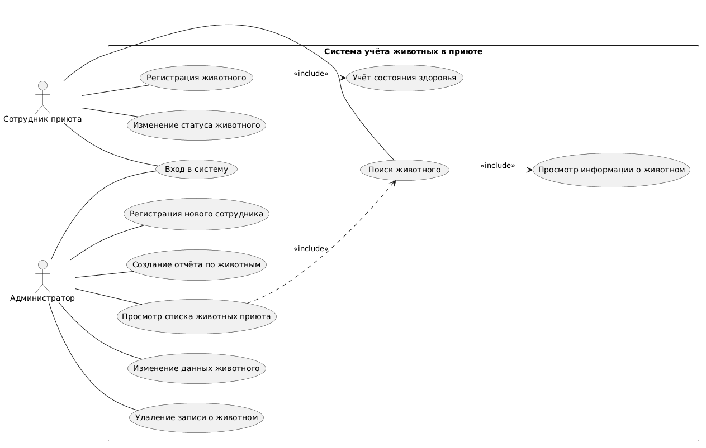

# Система учёта животных в приюте

**Система учёта животных в приюте** — учебный проект, предназначенный для описания информационной системы, автоматизирующей основные процессы работы приюта для животных. Проект направлен на упорядочивание информации о животных, упрощение поиска необходимых сведений и организацию работы сотрудников.

Предполагается, что система позволит вести записи о животных, отслеживать изменения их статусов, хранить сведения о состоянии здоровья и получать информацию о животных, находящихся в приюте.

В рамках текущей лабораторной работы основное внимание уделяется организации структуры проекта, подготовке документации, использованию системы контроля версий Git и созданию диаграммы вариантов использования с помощью PlantUML.

## Возможности системы

В проекте определены основные функции информационной системы для двух категорий пользователей: сотрудников приюта и администраторов.

### Для сотрудника приюта

- **Вход в систему** — получение доступа к функциям системы после авторизации.
- **Регистрация животного** — добавление информации о новом животном в систему.
- **Изменение статуса животного** — обновление сведений о текущем статусе животного.
- **Учёт состояния здоровья** — внесение и просмотр информации о состоянии здоровья животного.
- **Поиск животного** — поиск необходимой записи по доступным данным.
- **Просмотр информации о животном** — получение подробных сведений о выбранном животном.

### Для администратора

- **Вход в систему** — авторизация для работы с административными функциями.
- **Просмотр списка животных приюта** — получение общего списка зарегистрированных животных.
- **Поиск животного** — быстрый переход к необходимой записи.
- **Просмотр информации о животном** — ознакомление с данными выбранного животного.
- **Изменение данных животного** — редактирование ранее внесённой информации.
- **Удаление записи о животном** — удаление ненужной или ошибочной записи.
- **Регистрация нового сотрудника** — добавление учётной записи сотрудника.
- **Создание отчёта по животным** — подготовка сводной информации о животных приюта.

Перечисленные функции описывают предполагаемые возможности разрабатываемой системы и отражены в диаграмме вариантов использования. Наличие функции в модели не означает, что она уже реализована в программном коде.

## Структура проекта

Проект организован с разделением исходного кода, документации и материалов для тестирования.

```text
lab2-project/
│
├── README.md
│
├── src/
│   └── main.c
│
├── documents/
│   └── diagrams/
│       ├── use_case.puml
│       └── use_case.png
│
└── tests/
```

Назначение основных каталогов и файлов:

- **README.md** — описание проекта, его функций, структуры и способов работы с репозиторием.
- **src/** — каталог для хранения исходных файлов программы.
- **src/main.c** — основной файл программы на языке C.
- **documents/** — каталог с документацией и дополнительными материалами проекта.
- **documents/diagrams/** — каталог с диаграммами информационной системы.
- **use_case.puml** — редактируемый исходный текст диаграммы вариантов использования.
- **use_case.png** — изображение диаграммы, предназначенное для просмотра и включения в документацию.
- **tests/** — каталог, предназначенный для размещения тестовых материалов по мере развития проекта.

Такая организация позволяет отделить исходный код от документации и упростить дальнейшее расширение проекта.

## Модель работы системы

Информационная система предназначена для взаимодействия двух категорий пользователей: сотрудника приюта и администратора.

Сотрудник выполняет операции, связанные с учётом животных, регистрацией новых записей, изменением статусов и ведением информации о состоянии здоровья. Администратор дополнительно управляет записями, регистрирует сотрудников и формирует отчёты.

Общий принцип взаимодействия можно представить в виде следующей схемы:

```text
Пользователь
     |
     v
Вход в систему
     |
     v
Выбор необходимой функции
     |
     v
Выполнение операции
     |
     v
Получение результата
```

Данная схема представляет общий сценарий работы пользователя. Она является иллюстрацией последовательности действий и не заменяет UML-диаграмму вариантов использования.

## Архитектура проекта

На текущем этапе проект включает исходный файл программы на языке C и документацию, описывающую предполагаемую информационную систему.

Программная модель системы учёта животных может быть представлена следующим образом:

```text
Пользователь
     |
     v
Пользовательский интерфейс
     |
     v
Логика обработки операций
     |
     v
Хранение данных о животных
```

Каждый элемент отвечает за отдельную часть работы системы:

- **Пользовательский интерфейс** — обеспечивает взаимодействие пользователя с программой.
- **Логика обработки операций** — определяет порядок выполнения действий и обработки информации.
- **Хранение данных** — предназначено для сохранения сведений о животных и сотрудниках.

Эта схема показывает возможное разделение системы на основные части. В текущем учебном проекте такая архитектура рассматривается как модель дальнейшего развития, а не как описание уже реализованных программных модулей.

В дальнейшем разделение компонентов позволит упростить сопровождение программы, добавление новых функций и изменение способов хранения информации.

## Основные компоненты

### Исходный код программы

Исходный код размещается в каталоге `src/`. Главный файл `main.c` содержит функцию `main()`, с которой начинается выполнение программы на языке C.

На начальном этапе используется простая консольная программа, предназначенная для проверки настройки среды разработки, компиляции и запуска приложения.

### Документация

Файл `README.md` находится в корневом каталоге репозитория. Он содержит описание назначения проекта, возможностей информационной системы, структуры файлов и используемых инструментов.

Документация оформляется с помощью Markdown. Использование заголовков, списков, таблиц, ссылок и изображений делает описание более понятным и удобным для чтения.

### Диаграммы PlantUML

В каталоге `documents/diagrams/` хранятся исходный код и изображение диаграммы вариантов использования.

Исходный файл можно редактировать, чтобы изменять состав актёров, названия функций и связи между ними. После внесения изменений изображение диаграммы можно сформировать повторно.

## Диаграмма вариантов использования

Для описания взаимодействия пользователей с информационной системой используется диаграмма **Use Case**.

На диаграмме представлены два актёра:

1. **Сотрудник приюта** — выполняет операции по регистрации животных, изменению их статусов, учёту состояния здоровья и поиску информации.
2. **Администратор** — просматривает список животных, изменяет и удаляет записи, регистрирует новых сотрудников и создаёт отчёты.

Диаграмма позволяет определить основные функции системы и показать, какие пользователи взаимодействуют с каждой из них.

Исходный код диаграммы хранится в файле `documents/diagrams/use_case.puml`, а готовое изображение — в файле `documents/diagrams/use_case.png`.



## Используемые технологии и инструменты

| Технология или инструмент | Назначение |
|---|---|
| C | Язык программирования для создания учебной программы |
| Visual Studio Code | Редактирование исходного кода и документации |
| GCC или Clang | Компиляция программы на языке C |
| Git | Контроль версий и сохранение истории изменений |
| GitHub | Хранение удалённого репозитория |
| Markdown | Оформление файла README.md |
| PlantUML | Создание диаграммы вариантов использования |

## Требования к среде разработки

Для работы с проектом необходимы:

- компьютер с установленной операционной системой;
- Visual Studio Code;
- компилятор языка C, например GCC или Clang;
- Git;
- учётная запись GitHub для размещения проекта;
- расширение для работы с PlantUML в Visual Studio Code;
- средство просмотра и редактирования Markdown.

Для генерации диаграмм через локальную среду PlantUML может потребоваться Java. Конкретные требования зависят от выбранного способа формирования диаграммы.

## Установка и настройка проекта

### 1. Получение исходного кода

Репозиторий проекта размещён на GitHub:

[https://github.com/Daria446/lab2-project](https://github.com/Daria446/lab2-project)

Для получения копии репозитория используется команда:

```bash
git clone https://github.com/Daria446/lab2-project.git
cd lab2-project
```

### 2. Проверка структуры проекта

После получения репозитория необходимо убедиться, что в каталоге находятся файл `README.md`, исходный код программы и материалы диаграммы.

Ожидаемая структура каталогов приведена выше.

### 3. Проверка компилятора

Для проверки наличия компилятора можно выполнить команду:

```bash
gcc --version
```

Если используется Clang, можно проверить его командой:

```bash
clang --version
```

### 4. Компиляция программы

Если основной файл находится в `src/main.c`, для компиляции с помощью GCC или Clang используется команда:

```bash
gcc src/main.c -o main
```

После успешной компиляции будет создан исполняемый файл `main`.

### 5. Запуск программы

В macOS или Linux программу можно запустить командой:

```bash
./main
```

Если в исходном файле используется пример `Hello, World!`, программа выведет соответствующее сообщение в терминале.

## Работа с Git и GitHub

Git используется для контроля изменений в проекте. GitHub позволяет хранить удалённую копию репозитория и просматривать историю разработки.

Основные команды:

```bash
git status
git add .
git commit -m "Описание изменений"
git push
git pull
```

Назначение команд:

- `git status` — показывает изменённые, новые и подготовленные к коммиту файлы.
- `git add .` — добавляет изменения в подготовленную область.
- `git commit -m "Описание изменений"` — сохраняет подготовленные изменения в истории Git.
- `git push` — отправляет сохранённые коммиты в удалённый репозиторий.
- `git pull` — получает изменения из удалённого репозитория.

Пример последовательности действий при изменении документации:

```bash
git status
git add README.md
git commit -m "Update README"
git push
```

Перед отправкой изменений рекомендуется проверить состояние репозитория, чтобы убедиться, что необходимые файлы включены в коммит.

## Документирование проекта с помощью Markdown

Markdown используется для оформления текстовой документации. Он позволяет создавать структурированные документы без необходимости писать HTML-разметку вручную.

В данном README применяются следующие возможности Markdown:

- заголовки разных уровней;
- **полужирное выделение** важных терминов;
- маркированные и нумерованные списки;
- таблицы для описания инструментов;
- блоки кода для команд и примеров;
- гиперссылки на удалённый репозиторий;
- вставка изображения диаграммы.

Использование Markdown упрощает чтение документации непосредственно на GitHub и позволяет поддерживать единый стиль оформления проекта.

## Диаграммы проекта

Для графического представления функций системы используется PlantUML.

В каталоге `documents/diagrams/` размещаются следующие файлы:

- `use_case.puml` — исходный текст диаграммы вариантов использования;
- `use_case.png` — изображение диаграммы.

Хранение исходного текста позволяет редактировать диаграмму без необходимости создавать её заново. Изображение используется для просмотра схемы на GitHub и включения в документацию.

В дальнейшем проект можно дополнить другими диаграммами, например диаграммой компонентов или последовательности взаимодействия пользователя с системой.

## Перспективы развития

В дальнейшем информационную систему можно расширить следующими возможностями:

- добавление пользовательского интерфейса;
- сохранение сведений о животных в базе данных;
- поиск по нескольким параметрам;
- фильтрация и сортировка списка животных;
- ведение истории изменения статусов;
- расширение учёта состояния здоровья;
- разграничение прав доступа сотрудников;
- формирование подробных отчётов.

Эти функции являются возможными направлениями развития проекта и не заявляются как уже реализованные.

## Лицензия

Проект является учебным и создан в рамках выполнения лабораторной работы. Отдельная лицензия в текущей версии не добавлена. При необходимости условия использования проекта могут быть определены позднее в файле `LICENSE`.

## Заключение

В ходе выполнения лабораторной работы формируется структура программного проекта, подготавливается документация, осваиваются основные команды Git и работа с удалённым репозиторием GitHub. Также создаётся диаграмма вариантов использования с помощью PlantUML и изучаются возможности оформления документации средствами Markdown.

Результатом является организованный учебный репозиторий, содержащий исходный код программы, документацию и графическое представление основных функций информационной системы учёта животных в приюте.